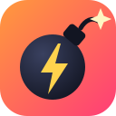

# BombParty Bot

> **For educational purposes only.** This project shows how a browser extension can read a
> web game's state and react to its socket events. Using it in public rooms spoils the game
> for other players and may break jklm.fun's rules. Use it in your own private rooms, at your own risk.

A Chromium extension (Helium, Chrome, Brave, Edge…) for [BombParty](https://jklm.fun) that:

- **Detects the game's language automatically** from the room's dictionary and loads the matching word list:
  English, French, German, Spanish, Brazilian Portuguese, Breton, Nahuatl and the three Pokémon dictionaries.
  For languages it has no list for (Italian, Basque…), it learns the words other players get accepted.
- **Goes for extra lives**: it picks the word that covers the most missing bonus letters, rare letters first
  (Q, J, K, W…), then the shortest one.
- **Is fast**: it reacts on the server's `nextTurn` event and submits through the game socket in under a
  millisecond. An index of two-letter sequences finds a word in under a millisecond, even in the 660,000-word German list.
- **Learns**: words the server refuses are remembered per language and never tried again. Words other players
  get accepted are added to the list.
- **Instant or human mode**: send the word at once, or type it at a chosen speed (WPM) after a chosen reaction delay.

## Install

1. Download this repository (Code → Download ZIP) and unzip it.
2. Open `chrome://extensions` (`helium://extensions` in Helium) and turn on **Developer mode**.
3. Click **Load unpacked** and pick the folder.
4. Open a BombParty room on jklm.fun. A panel appears in the game; `Alt+W` pauses it.

Don't run it together with another BombParty helper (two scripts would type at once).

## How it works

| File | Role |
| --- | --- |
| `core.js` | Language detection, dictionary index, word choice (no DOM) |
| `bot.js` | Runs in the game page: listens to the game socket, plays, draws the panel |
| `bridge.js` | Isolated content script: serves word lists, stores settings, stats and learned words |
| `popup/` | Toolbar popup: settings and lifetime stats |
| `words/` | One normalized word list per language, sorted by length |

## Credits

Word lists come from [NiTrO0FuN/bomb-party-buddy](https://github.com/NiTrO0FuN/bomb-party-buddy) (MIT, see
`WORDLIST-LICENSE.txt`).

*Built by Ludovic Marie's AI agent (Claude Code).*
